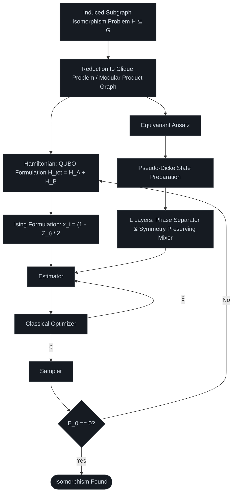
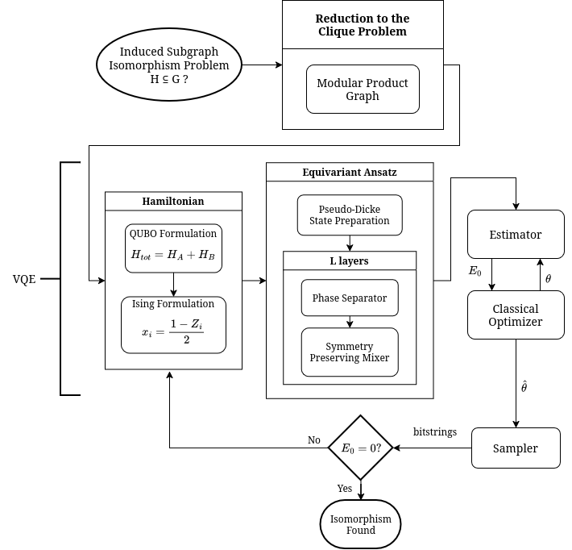

# qgraphs: VQE solver for the Induced Subgraph Isomorphism Problem

A variational quantum computing framework designed to solve the **induced subgraph isomorphism problem** ($H \subseteq G$) using a hybrid quantum-classical Variational Quantum Eigensolver (VQE) architecture, featuring problem-tailored QUBO-to-Ising mappings and equivariant ansatze. Developed for **QAMP 2025**.

## 🔬 Core Methodology & Pipeline

The pipeline reduces subgraph isomorphism to a maximum clique variation via modular product graphs, maps it to a constrained Hamiltonian, and optimizes it using symmetry-preserving quantum circuits.

## 🛠️ Key Architectural Components

* **Problem Reduction:** Formulates graph matching via modular product graphs and maps constraints into Quadratic Unconstrained Binary Optimization (QUBO).
* **Ising Transformation:** Converts binary decision variables to Pauli-Z operators via $x_i = \frac{1 - Z_i}{2}$.
* **Equivariant Ansatz:** Implements efficient search-space restriction using Pseudo-Dicke state preparation followed by parameterized layers of phase separators and symmetry-preserving mixers.
* **Hybrid Optimization Loop:** Iteratively minimizes expectation value $E_0$ via classical optimizers until the zero-energy ground state confirms isomorphism.

## 📚 References & Literature

*List of foundational papers and resources utilized in this implementation:*

### Ising & QUBO
- Lucas, A. (2014). *Ising formulations of many NP problems* [DOI](https://arxiv.org/abs/1302.5843)
- Zick, K. (2015). *Experimental quantum annealing: case study involving the graph isomorphism problem* [DOI](https://doi.org/10.1038/srep11168)
- Calude, C. (2017). *QUBO formulations for the graph isomorphism problem and related problems* [DOI](http://dx.doi.org/10.1016/j.tcs.2017.04.016)
- Huang, N. (2020). *A New QUBO Objective Function For Solving the Maximum Common Subgraph Isomorphism Problem Via Quantum Annealing* [DOI](https://doi.org/10.1007/s42979-020-00431-5)

### EQC
- Skolik, A. (2023). *Equivariant quantum circuits for learning on weighted graphs* [DOI](https://doi.org/10.1038/s41534-023-00710-y)
- Mernyei, P. (2022). *Equivariant Quantum Graph Circuits* [DOI](https://doi.org/10.48550/arXiv.2112.05261)
